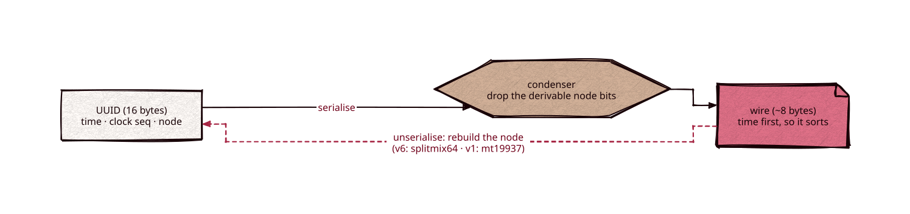

# cuuid

Part of [Kronuz C++ Libraries](https://github.com/Kronuz/cpp-libraries), a collection of small, reusable C++ libraries.

[](https://github.com/Kronuz/cuuid/actions/workflows/ci.yml)
[](LICENSE)


Condensed UUIDs for C++20: standard 16-byte UUIDs that serialize to about 8
time-sortable bytes, with no worker-id coordination. That is half of UUIDv7, and the
same as a 64-bit Snowflake.



## ✨ Highlights

- 📏 **About 8 bytes on the wire** for present-day ids; the full 16-byte form is
  always available.
- 🔢 **Sorts by creation time** in its condensed form, as a database key.
- ⚡ **v6, the default**: UUIDv6 layout and splitmix64 node reconstruction, about
  9 ns to encode and 12 ns to decode.
- 🧊 **v1, frozen**: Xapiand's original codec, byte for byte, for existing data
  (`Codec::v1`).
- 🔍 **Validators and accessors**: `is_valid()`, `is_serialised()`, and the v1 node,
  time, clock sequence, variant, and version fields.

## 📦 Installation

Requires a C++20 compiler, CMake 3.14 or newer, and the platform UUID library
(libuuid on Linux; built in on macOS and FreeBSD). It brings
[endian](https://github.com/Kronuz/endian) and
[char-classify](https://github.com/Kronuz/char-classify). CI builds it on Linux
(x86_64, arm64), macOS (arm64, x86_64), and FreeBSD, plus ASan, UBSan, and TSan
builds.

```cmake
include(FetchContent)
FetchContent_Declare(cuuid
  GIT_REPOSITORY https://github.com/Kronuz/cuuid.git
  GIT_TAG        main)
FetchContent_MakeAvailable(cuuid)

target_link_libraries(my_app PRIVATE cuuid::cuuid)
```

## 🚀 Quick start

```cpp
#include "cuuid.hh"

#include <cassert>
#include <iostream>

int main() {
	UUID id = cuuid::generate();                   // v6
	std::string wire = cuuid::serialise(id);       // ~8 bytes, sorts by time
	assert(cuuid::unserialise(wire) == id);
	std::cout << id << " -> " << wire.size() << " bytes\n";
}
```

Decoding uses the codec you run: `Codec::v6` by default, or `Codec::v1` for data
written by the original codec. The condensed wire carries no version marker.

## ⚙️ Configuration

A host can replace three seams by defining a header before the build:
`CUUID_TRACE_HEADER` (logging), `CUUID_EXCEPTION_HEADER` (errors), and
`CUUID_NODE_HEADER` (the local node salt).

## 🎯 When to use it

- ✅ Billions of ids stored as keys, small and time-sorted, without coordination,
  where you control both ends of the wire.
- ❌ A greenfield system that must interoperate: use UUIDv7. Or use Snowflake if
  64-bit ids with worker coordination are acceptable.

## 📚 Documentation

- [ARCHITECTURE.md](ARCHITECTURE.md): the condenser and the wire format.
- [docs/COMPARISON.md](docs/COMPARISON.md): against Snowflake, UUIDv6, UUIDv7, and
  ULID, with benchmarks.
- [docs/CUUID_V6.md](docs/CUUID_V6.md): the v6 format.
- [docs/MIGRATION.md](docs/MIGRATION.md): rolling out v6 beside v1.
- [AGENTS.md](AGENTS.md): repository map and invariants.

## 🛠️ Building and testing

```sh
cmake -B build -DCMAKE_BUILD_TYPE=Release && cmake --build build
ctest --test-dir build
./build/cuuid_demo && ./build/cuuid_compare
```

## 🤝 Contributing

Issues and pull requests are welcome. Read [AGENTS.md](AGENTS.md) first. CI must
pass on every platform.

## 📄 License

MIT, Copyright (c) 2015-2019 Dubalu LLC. See [LICENSE](LICENSE). Extracted from
[Xapiand](https://github.com/Kronuz/Xapiand).
